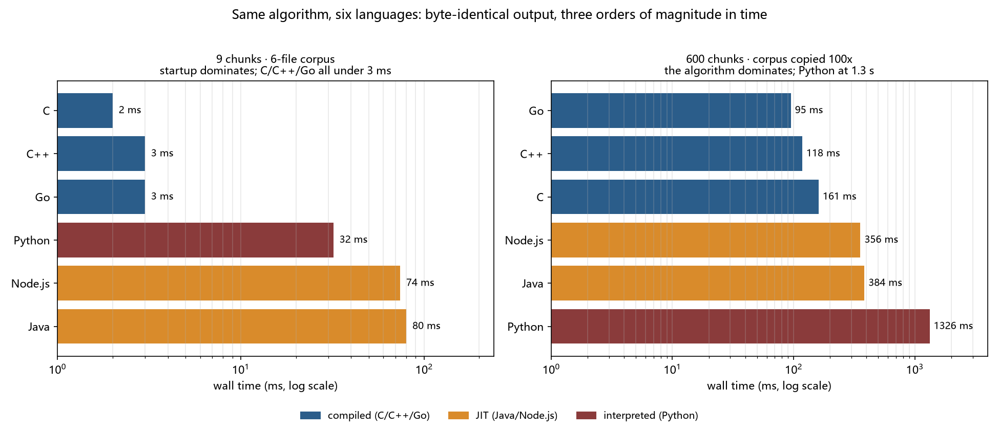

# One algorithm, six languages — byte-identical, and it keeps a log

> ## ⚠️ Not an end-user product
>
> **This is a developer-facing reference implementation of a retrieval algorithm,
> not an out-of-the-box AI knowledge base.**
>
> There is no UI, no PDF pipeline, no database, no embedding service and no LLM in
> this repo. What you get is the ~200-line core: chunking, chunk-level timestamps,
> a hash-vector embedding, hybrid scoring and time decay — six times, one per
> language, all printing the same bytes.
>
> If you want a product that ingests your files and answers questions, use
> LlamaIndex, LangChain, RAGFlow or Dify. If you want to understand, port or embed
> the scoring logic yourself, read on.
>

**One algorithm, six languages, byte-identical output.** Plus a usage log that tells you whether retrieval actually helped.

同一算法、六种语言、逐字节一致。外加一份使用日志，回答「它到底帮上忙没有」。

This repo is the **portability test** for [decay-rag](../decay-rag). Same spec, same
corpus, same queries, six implementations. The acceptance criterion is boring and
strict: **every language must print the same bytes**.

```
$ ./verify.sh
python3  ok   4 lines
node     ok   4 lines
gcc      ok   4 lines
g++      ok   4 lines
go       ok   4 lines
java     ok   4 lines
all six implementations agree (sha256 3f7c1a0e…)
```

## What the algorithm does

Chunk a document → give every chunk a timestamp → score with
`0.72 * vector cosine + 0.28 * literal bigram overlap`, then
`0.75 * similarity + 0.25 * time decay`. Newer evidence wins when the text is
equally relevant; old evidence still shows up, just discounted.

Full, implementation-ready spec: [`docs/SPEC.md`](docs/SPEC.md).
The only "model" is a 4096-dimension signed hash of character bigrams — no
embeddings, no downloads, no GPU. That is exactly why it ports.

## The six ports

| Language | File | Lines | Build | Run |
|---|---|---:|---|---|
| Python | `py/ref.py` | 172 | — | `python3 py/ref.py` |
| JavaScript (Node 18+) | `js/decay.mjs` | 126 | — | `node js/decay.mjs` |
| C11 | `c/decay.c` | 262 | `gcc -O2 -o decay c/decay.c -lm` | `./decay` |
| C++17 | `cpp/decay.cpp` | 205 | `g++ -std=c++17 -O2 -o decay cpp/decay.cpp` | `./decay` |
| Go 1.21+ | `go/main.go` | 214 | `go build -o decay ./go` | `./decay` |
| Java 17+ | `java/DecayRag.java` | 176 | `javac -d out java/DecayRag.java` | `java -cp out DecayRag` |

## Do they actually behave the same?

Yes — byte-identical output, and the six-way comparison is what caught a real bug
in the C port (`MAX_CHUNKS 512` overflow at 600 blocks). Details:
[`docs/BENCHMARKS.md`](docs/BENCHMARKS.md).



Compiled ports finish a 600-chunk query in 95–161 ms, Python in 1.3 s. On the
6-file sample everything is startup-bound and the gap is meaningless.


Each program takes an optional root argument (default `.`) and reads
`data/corpus/*.md` plus `data/queries.txt`.

## Verified output

`expected.txt` is produced by the Python reference; every other port is diffed
against it. All four queries and all twelve `(chunk, score)` pairs match to the
last digit — including the `0.250000` entries where a document has no date in its
name or body, so its timestamp falls back to the file mtime.

## What actually broke while porting (the useful part)

Portability is not "the syntax compiles". These four bugs showed up:

1. **C++ `std::filesystem::last_write_time` is not the Unix epoch.**
   `time_since_epoch()` returned a different origin on libstdc++, so the
   mtime-derived timestamps were off and one ranking changed. Fix: `::stat` +
   `st_mtime`. C, Go, Java and Node all agreed with each other, which is how the
   outlier was spotted.
2. **Java decodes file names with `sun.jnu.encoding`, not `file.encoding`.**
   Under the `POSIX` locale the Chinese fixture names came back as `????`.
   Fix: run with `LANG=C.UTF-8` **and** `-Dsun.jnu.encoding=UTF-8`, and wrap
   `System.out` in a UTF-8 `PrintStream`.
3. **Go needs an explicit module context.** `go run ./go` fails without
   `go.mod`; `go run go/main.go` works, or add a one-line module.
4. **Float formatting is part of the contract.** Python's `round(x, 6)` prints
   `0.32559`, C's `%.6f` prints `0.325590`. The spec therefore fixes the output
   to `%.6f` everywhere, and the Python reference formats with the same width.

Two more, environment-level, that are not language bugs but will bite you:
`apt-get` against `archive.ubuntu.com` returned 502 during this test (switched to
a mirror), and a Windows host has no JDK/Go by default, so those two were
verified inside Docker.

## Determinism rules that make byte equality possible

- Dates are converted with **days-from-civil (Hinnant)**, never `mktime`, so no
  timezone leaks in.
- The reference "now" is read from `data/queries.txt`, not the system clock.
- Hashing is **FNV-1a 64** over the two code points as little-endian `uint32`s —
  identical in every runtime, unlike `hash()` or `Object.hashCode()`.
- Ties are broken by chunk id in byte order, never by insertion order.
- All arithmetic is IEEE-754 double, and every port accumulates the dot product
  in the same index order.

## Run the check

```bash
./verify.sh            # Linux/macOS; needs python3, node, gcc, g++, go, javac
./verify.ps1           # Windows; runs what is installed, reports the rest as skip
```

The script writes each port's output to `out/<lang>.txt`, diffs against
`py/expected.txt`, and prints a single sha256 of the concatenated outputs.

## License

Business Source License 1.1 — source is visible and free for personal,
academic and internal non-commercial use; commercial use needs a license.
Change Date: 2030-11-17, after which it becomes Apache-2.0. See [LICENSE](LICENSE).

## Do the ports agree?

**Are the six ports the same?** Byte-identical output — and the comparison found one real bug (a 512-chunk static array in the C port). Numbers: [docs/BENCHMARKS.md](docs/BENCHMARKS.md).
