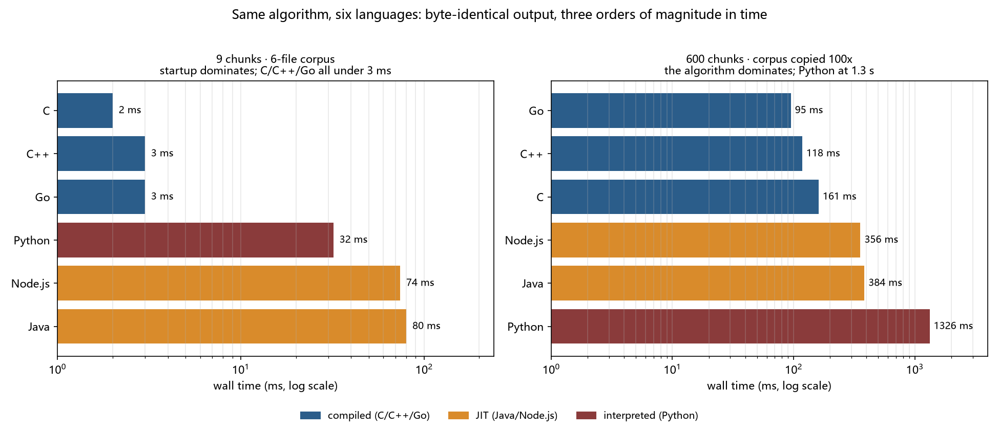

# Six languages, one algorithm: are the ports the same?

Short answer: **yes on correctness, and one of them was not — a bug the comparison found.**

## Correctness: byte-identical output

All six implementations read `data/` and print the same JSON. Verified with `md5sum`:

```
e24c5be7…  c_bin      cpp_bin   go_bin   DecayRag (java)   ref.py (python)   decay.mjs (node)
8e44376c…  ← same six, on the 600-block corpus
```

The check is byte-level, not "close enough": same chunks, same order, same six decimals.

## The bug it found

The C port originally declared

```c
#define MAX_CHUNKS 512
static Chunk chunks[MAX_CHUNKS];
```

At 600 blocks the process died with `*** buffer overflow detected ***` (glibc fortify),
while the other five kept working. The sample corpus has 9 blocks, so the port looked
fine for as long as nobody grew the corpus.

Fixed by growing the array:

```c
static Chunk *chunks = NULL;
static int cap_chunks = 0;
...
if (nchunks == cap_chunks) {
    cap_chunks = cap_chunks ? cap_chunks * 2 : 256;
    chunks = realloc(chunks, sizeof(Chunk) * (size_t)cap_chunks);
}
```

Re-verified identical to C++/Go/Java/Python/Node on the 600-block corpus.

**Lesson**: a comparison across implementations is also a test suite. Five agreeing
implementations are what made the sixth look wrong.

## Speed (same corpus, same 4 queries, median of 7–15 runs)

Linux container (Ubuntu 24.04, x86-64, gcc 13.3, Go 1.25.3, OpenJDK 21, Node 18.19,
CPython 3.12), one core, cold process every run:

| language | 9 blocks | 600 blocks | what dominates |
|---|---|---|---|
| Go | 3 ms | **95 ms** | nothing much |
| C++ | 3 ms | **118 ms** | fine |
| C | 2 ms | **161 ms** | dense 4096-double centroid per chunk |
| Node.js | 74 ms | **356 ms** | V8 startup (~70 ms) |
| Java | 80 ms | **384 ms** | JVM startup (~28 ms) + JIT warm-up |
| Python | 32 ms | **1326 ms** | the interpreter loop over 4096 dims |




Reading it:

- **Small corpora: everything is instant.** At 9 blocks the whole run — startup, index,
  4 queries — is 2–100 ms. Startup dominates; the algorithm does not.
- **Python is the only one that falls behind.** 1.3 s for 600 blocks, ~14× Go. That is
  the cost of looping 4096 dimensions in the interpreter; the algorithm itself is fine.
  For a personal library in the low thousands of blocks it is still usable, just not instant.
- **Startup is half the story for the managed runtimes.** Java and Node pay 28/70 ms before
  doing any work, which is why they lose at 9 blocks and stay mid-pack at 600.

## Reproducing

```bash
# correctness (any two of the six)
cd c    && gcc -O2 -std=gnu11 -o /tmp/c_bin decay.c -lm && /tmp/c_bin .. > /tmp/c.txt
cd cpp  && g++ -O2 -std=c++17 -o /tmp/cpp_bin decay.cpp      && /tmp/cpp_bin .. > /tmp/cpp.txt
cmp /tmp/c.txt /tmp/cpp.txt && echo identical

# timing
for i in $(seq 1 15); do
  /usr/bin/time -f %e /tmp/go_bin ..
done
```

The 600-block corpus used here is `data/corpus/*.md` copied 100 times with a `_N`
suffix — same content, more chunks. It is generated, not shipped.
